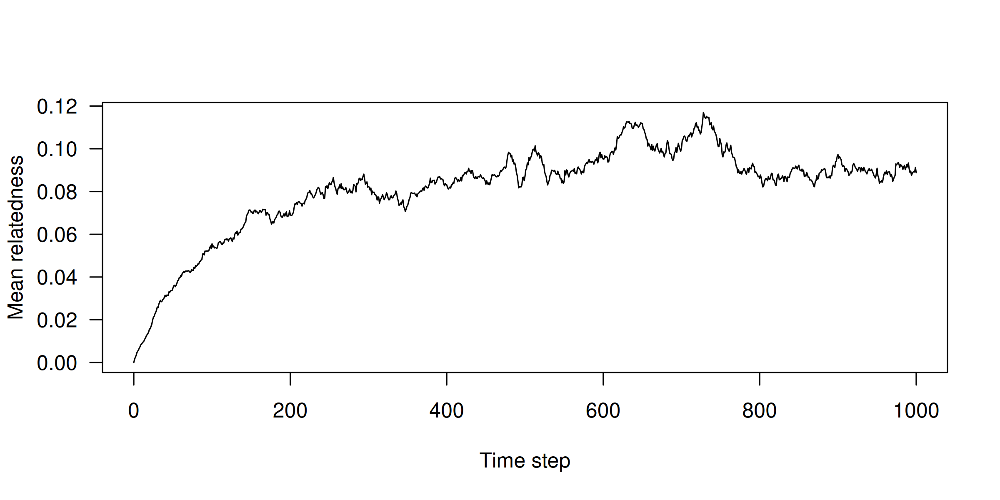

# fastrel

```{r settings, echo = FALSE}
unlink(".github/figures", recursive = TRUE)
dir.create(".github/figures")
```

**fast** **rel**atedness (aka `fastrel`) is an R package to compute relatedness,
relationship or kinship from a pedigree quickly.

This package offers four main sets of functionalities:

- a set of functions allowing for updating a relatedness matrix, conceived with
individual based simulations in mind, with no need to store a pedigree, and with
a computation time and memory footprint that do not increase over time as long as
the population is at its demographic equilibrium
(it only requires storing the information about alive individuals)
- a function to compute relatedness from a pedigree more quickly than
[`ggroups`](https://cran.r-project.org/web/packages/ggroups/index.html), [`kinship2`](https://cran.r-project.org/web/packages/kinship2/index.html) or
[`Pedixplorer`](https://louislenezet.github.io/Pedixplorer/)
(which now supersedes `kinship2`)
- a function to simulate a pedigree (with character or integer identifiers)
- a function to simulate a population with its pedigree, deaths, births,
immigrations and emigrations.

The relatedness matrix is here technically defined as the additive relationship matrix, A = 2 × kinship, with diagonal 1 + F.
Its values lie between 0 and 2.
Between individuals that are not inbred, relatedness is at most 1 (identical twins or clones; 0.5 for parent and offspring or full siblings), and it can only exceed 1 with inbreeding.

The kinship coefficient, Wright's coefficient of relationship and Hamilton's regression coefficient of relatedness can be returned instead (see [Measures of relatedness](#measures-of-relatedness)).

All four measures are validated in the tests of the package against two independent implementations, [`kinship2`](https://cran.r-project.org/package=kinship2) and [`ggroups`](https://cran.r-project.org/package=ggroups), on pedigrees of many shapes (with inbreeding, selfing, unknown parents and unsorted rows).

| Task | Functions |
|---|---|
| Relatedness of a whole pedigree | `fastrel_ped()` (from a data frame), `fastrel_vec()` (from vectors) |
| Relatedness updated step by step (the "store") | `rel_new()`, `rel_add()`, `rel_remove()`, `rel_get()` |
| Content of a relatedness store | `rel_ids()`, `rel_size()`, `rel_capacity()` |
| Saving and restoring a store | `rel_save()`, `rel_load()` |
| Simulating data | `sim_ped()`, `sim_pop()` |


## Installation

The installation requires the compilation of the C++ code, so you need a C++
compiler installed:

- on Linux, those are often installed by default
- on Windows, you will need [Rtools](https://cran.r-project.org/bin/windows/Rtools/)
(same version as your R)
- on MacOS, you will need [Apple Command Line Tools](https://developer.apple.com/download/)
or equivalent.

You may then use [pak](https://pak.r-lib.org/) to install the package:
```{r installation, eval = FALSE}
if (!requireNamespace("pak")) {
  install.packages("pak")
}
pak::pkg_install("courtiol/fastrel")
```

## Basic examples

### Compute the relatedness of a whole pedigree at once

```{r fastrel_ped}
library(fastrel)
set.seed(1) # for reproducibility
ped <- sim_ped(1000)
tail(ped, n = 3) # last 3 individuals
A <- fastrel_ped(ped) # same as fastrel_vec(ped$id, dadid = ped$dadid, momid = ped$momid)
A[998:1000, 998:1000] # relatedness matrix between those 3 individuals
max(diag(A) - 1)   # maximum inbreeding coefficients
```

### Compute the relatedness incrementally (for simulations)

```{r rel_new}
rel <- rel_new() # initialize the store (once per simulation)
rel_add(rel, data.frame(id = c("A", "B"), mom = NA, dad = NA)) # add founders
rel_add(rel, data.frame(id = c("C", "D"), mom = c("A", "A"), dad = c(NA, "B"))) # add births
rel_remove(rel, c("A", "B")) # remove dead / emigrated: free their slots
rel_get(rel) # extract relatedness matrix between remaining individuals
```

`fastrel_ped()` and `rel_add()` find the columns they need by their names, and the usual names are recognised (e.g. `id`, `focal` or `animal`; `mom`, `mum`,
`mother` or `dam`; `dad`, `father` or `sire`; with or without `id`, as in
`momid` or `mother_id`): see `?fastrel_ped` for the list.

## Measures of relatedness

By default, the package returns the additive relationship A = 2 × kinship
(diagonal 1 + F, where F is the inbreeding coefficient). `fastrel_ped()`,
`fastrel_vec()` and `rel_get()` can return three other measures with their
argument `metric`:

| `metric` | Measure | Definition | Range | Typical use |
|---|---|---|---|---|
| `"additive"` (default) | additive (numerator) relationship | A = 2 × kinship | 0 to 2 | covariance of breeding values (animal models, heritability) |
| `"kinship"` | kinship (coancestry) coefficient | probability that two alleles drawn at random, one from each individual, are identical by descent | 0 to 1 | probability of identity by descent; same as `kinship2::kinship()` |
| `"wright"` | Wright's coefficient of relationship | correlation between genetic values, `cov2cor(A)` | 0 to 1 | genetic resemblance compared with that of an individual to itself (1 = as similar as an individual is to itself), whatever the inbreeding |
| `"hamilton"` | regression coefficient of relatedness | regression of the recipient's genetic value on the actor's, A[i, j] / A[i, i] | 0 to 1 | the *r* of Hamilton's rule (kin selection); not symmetric: rows are actors |

Without inbreeding, all measures except the kinship coefficient are identical
(0.5 for parent and offspring or full siblings, 0.25 for half siblings), and the
kinship coefficient is half of them. The measures only differ with inbreeding,
as in this pedigree where an individual (P) is obtained by selfing a founder (G),
and two individuals (O1, O2) by selfing P:

```{r metrics}
ped_selfing <- data.frame(id  = c("G", "P", "O1", "O2"),
                          mom = c(NA, "G", "P", "P"),
                          dad = c(NA, "G", "P", "P"))
fastrel_ped(ped_selfing)                      # additive relationship
fastrel_ped(ped_selfing, metric = "kinship")  # probabilities
fastrel_ped(ped_selfing, metric = "wright")   # correlations
fastrel_ped(ped_selfing, metric = "hamilton") # regressions (row = actor)
```

See `?relatedness_metrics` for the definitions, their interpretation and the
references.

## Using the store in a simulation

The *store* created by `rel_new()` is an object that keeps the relatedness
matrix among the individuals currently in it, and that `rel_add()` and
`rel_remove()` update directly (there is no need to reassign their result).
Each individual in the store occupies a *slot*, i.e. one row and the matching
column of that matrix; removing an individual frees its slot for an individual
added later. This section explains how to use the store well.

### Who to keep and who to remove

Keep an individual in the store for as long as it can still become a parent, or
for as long as you want to know its relatedness to others. Remove everybody
else (dead, emigrated, ...) with `rel_remove()`.

Removing every individual that can no longer become a parent
implies that the computational cost of adding a birth to the stored relatedness
information and the memory used depend on the number of individuals in the store,
not on the length of the pedigree.

Removal is final: an individual that was removed must not be added again, since
its relatedness with the individuals born in the meantime is unknown (it would
come back as unrelated to everybody).

### A complete example

`sim_pop()` simulates a population with births, deaths, emigration and
immigration, and returns the step at which each individual arrives and leaves.
Here we replay it with a store, adding the arrivals and removing the departures
at each step, and we record the mean relatedness among the individuals present:

```{r simulation, fig.path=".github/figures/", fig.width=8, fig.height=4, dpi=150, out.width="100%", fig.show='hide'}
rel <- rel_new()
set.seed(1)
pop <- sim_pop(n_steps = 1000, n_init = 200) # simulate pop (fine tuning the life history is possible)
head(pop) # first 6 simulated individual life histories (no momid and dadid since founder)
mean_relatedness <- data.frame(step = 0:1000, mean_rel = NA) # record mean relatedness
for (t in 0:1000) {
  rel_add(rel, pop[pop$arrival == t, c("id", "momid", "dadid")])
  rel_remove(rel, pop$id[!is.na(pop$exit) & pop$exit == t])
  A <- rel_get(rel)
  mean_relatedness[mean_relatedness$step == t, "mean_rel"] <- mean(A[upper.tri(A)])
}
plot(mean_rel ~ step, data = mean_relatedness,
     type = "l", las = 1,
     ylab = "Mean relatedness", xlab = "Time step")
```

<p align="center">

</p>

Although `r nrow(pop)` individuals were simulated in total, the store never
held more than a few hundred of them at once:

```{r rel_size}
rel_size(rel)     # individuals currently in the store
```

### Metapopulations

To model a metapopulation, use a single store for all the patches and keep the
migrants in it: remove an individual only when it dies or leaves the
metapopulation for good. Keep track of the patch of each individual on your
side, and extract a patch with `rel_get(rel, ids_of_the_patch)`. Migrants then
keep their relatedness with the relatives they left behind and with the
offspring they produce elsewhere.

```{r metapop}
rel <- rel_new(remember_removed = TRUE)
rel_add(rel, data.frame(id = c("a1", "a2", "b1", "b2"), mom = NA, dad = NA))
patch <- c(a1 = "A", a2 = "A", b1 = "B", b2 = "B") # the patch of each individual
rel_add(rel, data.frame(id = "a3", mom = "a1", dad = "a2")) # a3 is born in patch A...
patch["a3"] <- "B"                                          # ... and moves to patch B
rel_add(rel, data.frame(id = "b3", mom = "b1", dad = "a3")) # where it reproduces
patch["b3"] <- "B"
rel_get(rel, names(patch)[patch == "B"]) # relatedness within patch B
rel_get(rel)["b3", "a1"] # b3 remains related to its grandparent in patch A
```

In that case we recommend creating the store with
`rel_new(remember_removed = TRUE)`, as above: `rel_add()` then raises an error if an
individual that was removed is added again, a mistake that is easy to make when
individuals move between patches. This is off by default because it costs about
30 bytes per individual removed, so the memory used then grows (slowly) with
the length of the pedigree. This trace relies on a fingerprint of each identifier,
which could in principle be mistaken for that of another one, with a negligible
probability; `rel_new(remember_removed = "id")` keeps the identifiers themselves
instead, which can never be wrong but takes more memory (about 70 bytes per
individual removed for short identifiers). See `?rel_new` for details.

### Saving and loading the relatedness store

Since the store is a C++ object, you need to use specific functions to save and
restore it:

```{r saving, eval = FALSE}
rel_save(rel, "store.rds")
rel <- rel_load("store.rds") # a working store again
```

## Benchmarks

The relatedness metrics are computed much faster by `fastrel` than by `ggroups`
or `kinship2` under virtually all conditions. Here is an example, using a pedigree simulated with integer
identifiers and 0 for unknown parents, which suits all three packages:

```{r benchmark, message = FALSE, warning = FALSE}
library(microbenchmark)
library(ggroups)
library(kinship2)

set.seed(1) # for reproducibility
ped <- sim_ped(1000, numeric_ids = TRUE)
head(ped, n = 3)

# check that the computed relatedness are the same
all.equal(unname(buildA(ped[, c("id", "dadid", "momid")])), # columns: individual, sire, dam
          unname(fastrel_ped(ped)))

all.equal(unname(kinship(ped$id, ped$dadid, ped$momid)),
          unname(fastrel_ped(ped, metric = "kinship")))

# benchmark
microbenchmark(ggroups = buildA(ped[, c("id", "dadid", "momid")]),
               kinship2 = kinship(ped$id, ped$dadid, ped$momid),
               fastrel_ped = fastrel_ped(ped),
               fastrel_vec = fastrel_vec(ped$id, ped$dadid, ped$momid,
                                         metric = "kinship"))
```

You can also run the more detailed integrated benchmarks as follows:

```{r more_benchmarks, eval = FALSE}
source(system.file("benchmarks/relstore_benchmark.R", package = "fastrel"))
source(system.file("benchmarks/sim_pop_benchmark.R", package = "fastrel"))
source(system.file("benchmarks/memory_benchmark.R", package = "fastrel")) # memory used (needs lobstr)
```


## Development

### AI/LLMs disclaimer

Most of this package was written with the help of large language models (LLMs),
such as Claude Fable 5.2. The increase in computational speed has been achieved
by relying heavily on a C++ implementation (rather than pure R code). The
results have been cross-checked using alternative LLMs and compared to the
output of established packages (`kinship2` and `ggroups`). Many tests have also been
implemented to ensure the results are accurate.

### Tips for developers

After editing README.Rmd, do:

```{r knit, eval = FALSE}
knitr::knit("README.Rmd")
```

After editing C++ attributes, do:

```{r Rcpp, eval = FALSE}
Rcpp::compileAttributes() # or "Build/Document" in RStudio 
```

To generate the manual, do:
```{r manual, eval = FALSE}
devtools::build_manual()
```


## Thanks

I thank Nikos Smit & Leonie F. Walter for their feedback on the package.
