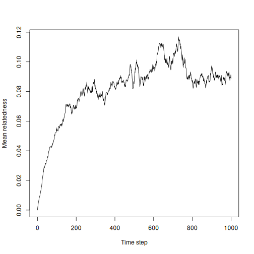

# fastrel

**fast** **rel**atedness (aka `fastrel`) is an R package to compute relatedness
from a pedigree quickly.

This package offers four main sets of functionalities:

- a set of functions allowing for updating a relatedness matrix, conceived with
individual based simulations in mind, with no need to store a pedigree, and with
a computation time and memory footprint that do not increase over time as long as
the population is at its demographic equilibrium
(it only requires storing the information about alive individuals)
- a function to compute relatedness from a pedigree more quickly than
[`ggroups`](https://cran.r-project.org/web/packages/ggroups/index.html), [`kinship2`](https://cran.r-project.org/web/packages/kinship2/index.html) or
[`Pedixplorer`](https://louislenezet.github.io/Pedixplorer/)
(which now supersedes `kinship2`)
- a function to simulate a pedigree
- a function to simulate a population with its pedigree, deaths, births,
immigrations and emigrations.

The functions have been written with Claude Sonnet 5.5 & Fable 5.2 in C++ and interfaced with R.

The relatedness matrix is here technically defined as the additive relationship matrix, A = 2 × kinship, with diagonal 1 + F.

| Task | Functions |
|---|---|
| Relatedness of a whole pedigree | `relatedness_fast()` |
| Relatedness updated step by step (the "store") | `rel_new()`, `rel_add()`, `rel_remove()`, `rel_get()` |
| Content of a store | `rel_ids()`, `rel_size()`, `rel_capacity()` |
| Saving and restoring a store | `rel_save()`, `rel_load()` |
| Simulating data | `sim_ped()`, `sim_pop()` |


## Installation

The installation requires the compilation of the C++ code, so you need a C++
compiler installed:

- on Linux, those are often installed by default
- on Windows, you will need [Rtools](https://cran.r-project.org/bin/windows/Rtools/)
(same version as your R)
- on MacOS, you will need [Apple Command Line Tools](https://developer.apple.com/download/)
or equivalent.

You may then use [pak](https://pak.r-lib.org/) to install the package simply:

``` r
if (!requireNamespace("pak")) {
  install.packages("pak")
}
pak::pkg_install("courtiol/fastrel")
```

## Basic examples

### Compute the relatedness of a whole pedigree at once


``` r
library(fastrel)
set.seed(1) # for reproducibility
ped <- sim_ped(1000)
tail(ped, n = 3) # last 3 individuals
```

```
##           id   momid   dadid sex
## 998  ind0998 ind0989 ind0959   1
## 999  ind0999 ind0912    <NA>   1
## 1000 ind1000 ind0871 ind0879   1
```

``` r
A <- relatedness_fast(ped$id, dadid = ped$dadid, momid = ped$momid)
A[998:1000, 998:1000] # relatedness matrix between those 3 individuals
```

```
##            ind0998    ind0999    ind1000
## ind0998 1.03676886 0.06467905 0.10907260
## ind0999 0.06467905 1.00000000 0.03918678
## ind1000 0.10907260 0.03918678 1.05214919
```

``` r
max(diag(A) - 1)   # maximum inbreeding coefficients
```

```
## [1] 0.3335501
```

### Compute the relatedness incrementally (for simulations)


``` r
rel <- rel_new() # initialize the store (once per simulation)
rel_add(rel, data.frame(id = c("A", "B"), mom = NA, dad = NA)) # add founders
rel_add(rel, data.frame(id = c("C", "D"), mom = c("A", "A"), dad = c(NA, "B"))) # add births
rel_remove(rel, c("A", "B")) # remove dead / emigrated: free their slots
rel_get(rel) # extract relatedness matrix between remaining individuals
```

```
##      C    D
## C 1.00 0.25
## D 0.25 1.00
```

## Using the store in a simulation

The store created by `rel_new()` holds the relatedness matrix among the
individuals currently in it. This section explains how to use it well.

### Who to keep and who to remove

Keep an individual in the store for as long as it can still become a parent, or
for as long as you want to know its relatedness to others. Remove everybody
else (dead, emigrated, ...) with `rel_remove()`.

Removing every individual that can no longer become a parent
implies that the computational cost of adding a birth to the stored relatedness
information and the memory used depend on the number of individuals in the store,
not on the length of the pedigree.

Removal is final: an individual that was removed must not be added again, since
its relatedness with the individuals born in the meantime is unknown (it would
come back as unrelated to everybody).

### A complete example

`sim_pop()` simulates a population with births, deaths, emigration and
immigration, and returns the step at which each individual arrives and leaves.
Here we replay it with a store, adding the arrivals and removing the departures
at each step, and we record the mean relatedness among the individuals present:


``` r
rel <- rel_new()
set.seed(1)
pop <- sim_pop(n_steps = 1000, n_init = 200) # simulate pop (fine tuning the life history is possible)
head(pop) # first 6 simulated individual life histories (no momid and dadid since founder)
```

```
##            id momid dadid sex arrival exit      fate  origin
## 1 ind00000001  <NA>  <NA>   1       0   20 emigrated founder
## 2 ind00000002  <NA>  <NA>   2       0    7      dead founder
## 3 ind00000003  <NA>  <NA>   1       0    2      dead founder
## 4 ind00000004  <NA>  <NA>   1       0    7      dead founder
## 5 ind00000005  <NA>  <NA>   2       0    3      dead founder
## 6 ind00000006  <NA>  <NA>   1       0   22      dead founder
```

``` r
mean_relatedness <- data.frame(step = 0:1000, mean_rel = NA) # record mean relatedness
for (t in 0:1000) {
  rel_add(rel, pop[pop$arrival == t, c("id", "momid", "dadid")])
  rel_remove(rel, pop$id[!is.na(pop$exit) & pop$exit == t])
  A <- rel_get(rel)
  mean_relatedness[mean_relatedness$step == t, "mean_rel"] <- mean(A[upper.tri(A)])
}
plot(mean_rel ~ step, data = mean_relatedness,
     type = "l", ylab = "Mean relatedness", xlab = "Time step")
```



Although 27150 individuals were simulated in total, the store never
held more than a few hundred of them at once:


``` r
rel_size(rel)     # individuals currently in the store
```

```
## [1] 241
```

``` r
rel_capacity(rel) # rows and columns allocated (memory used: 8 * capacity^2 bytes)
```

```
## [1] 301
```

### Metapopulations

To model a metapopulation, use a single store for all the patches and keep the
migrants in it: remove an individual only when it dies or leaves the
metapopulation for good. Keep track of the patch of each individual on your
side, and extract a patch with `rel_get(rel, ids_of_the_patch)`. Migrants then
keep their relatedness with the relatives they left behind and with the
offspring they produce elsewhere.


``` r
rel <- rel_new(remember_removed = TRUE)
rel_add(rel, data.frame(id = c("a1", "a2", "b1", "b2"), mom = NA, dad = NA))
patch <- c(a1 = "A", a2 = "A", b1 = "B", b2 = "B") # the patch of each individual
rel_add(rel, data.frame(id = "a3", mom = "a1", dad = "a2")) # a3 is born in patch A...
patch["a3"] <- "B"                                          # ... and moves to patch B
rel_add(rel, data.frame(id = "b3", mom = "b1", dad = "a3")) # where it reproduces
patch["b3"] <- "B"
rel_get(rel, names(patch)[patch == "B"]) # relatedness within patch B
```

```
##     b1 b2  a3  b3
## b1 1.0  0 0.0 0.5
## b2 0.0  1 0.0 0.0
## a3 0.0  0 1.0 0.5
## b3 0.5  0 0.5 1.0
```

``` r
rel_get(rel)["b3", "a1"] # b3 remains related to its grandparent in patch A
```

```
## [1] 0.25
```

In that case we recommend creating the store with
`rel_new(remember_removed = TRUE)`, as above: `rel_add()` then raises an error if an
individual that was removed is added again, a mistake that is easy to make when
individuals move between patches. This is off by default because it costs 11 to
23 bytes per individual removed, so the memory used then grows (slowly) with
the length of the pedigree. See `?rel_new` for details.

### Saving and loading the relatedness store

Since the store is a C++ object, you need to use specific functions to save and
restore it:


``` r
rel_save(rel, "store.rds")
rel <- rel_load("store.rds") # a working store again
```

## Benchmarks


``` r
library(microbenchmark)
library(ggroups)

# convert pedigree for ggroups
ID_num <- seq_len(nrow(ped))   # sim_ped() returns individuals in birth order
ped_ggroups <- data.frame(ID = ID_num,
                          SIRE = ID_num[match(ped$dadid, ped$id)],
                          DAM  = ID_num[match(ped$momid, ped$id)])
ped_ggroups$SIRE[is.na(ped_ggroups$SIRE)] <- 0
ped_ggroups$DAM[is.na(ped_ggroups$DAM)]   <- 0

# check that the computed relatedness are the same
all.equal(unname(as.matrix(buildA(ped_ggroups))),
          unname(relatedness_fast(ped$id, dadid = ped$dadid, momid = ped$momid)))
```

```
## [1] TRUE
```

``` r
# benchmark
microbenchmark(ggroups = buildA(ped_ggroups),
               fastrel = relatedness_fast(ped$id, dadid = ped$dadid, momid = ped$momid))
```

```
## Unit: microseconds
##     expr        min          lq       mean     median         uq      max neval
##  ggroups 106656.003 108879.8365 112814.961 113252.250 114619.569 125594.5   100
##  fastrel    687.349    807.5965   6890.753    977.092   5478.294 159534.0   100
##  cld
##   a 
##    b
```
As you can see `fastrel::relatedness_fast()` is much faster than `ggroups::buildA()` on our machine, for 1000 individuals.


You can also run the integrated benchmarks as follows:


``` r
source(system.file("benchmarks/relstore_benchmark.R", package = "fastrel"))
source(system.file("benchmarks/sim_pop_benchmark.R", package = "fastrel"))
```


## Development

After editing README.Rmd, do:


``` r
unlink("figure", recursive = TRUE)
knitr::knit("README.Rmd")
```

After editing C++ attributes, do:


``` r
Rcpp::compileAttributes()
```

## Thanks

I thank Nikos Smit & Leonie F. Walter for their feedback on the package.
